# AppDock

<p align="center">
  
</p>

<p align="center">
  <strong>Sleek, high-performance Windows application and URL dock launcher.</strong><br />
  Built with React 19, TypeScript, Tailwind CSS, and Electron.
</p>

<p align="center">
  <a href="https://github.com/DevlopTecy/AppDock/releases"></a>
  
  
  
  
</p>

---

## Visual Showcase

### Basic Themes

AppDock includes clean, high-contrast foundational themes built for seamless everyday productivity:

| Dark Theme (Default) | Light Theme |
|:---:|:---:|
|  | 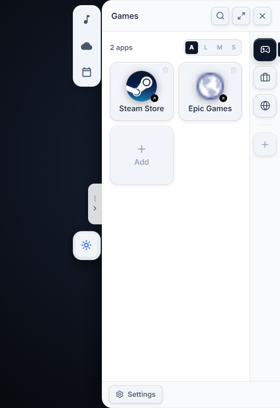 |
| *Deep dark neutral surfaces with vibrant category accents* | *Crisp, light daylight aesthetic with high-contrast text* |

---

### Flexible App UI Sizes

AppDock's responsive layout dynamically scales to match your preferred icon density:

| Large Density (L) | Medium Density (M) | Small Density (S) |
|:---:|:---:|:---:|
|  | 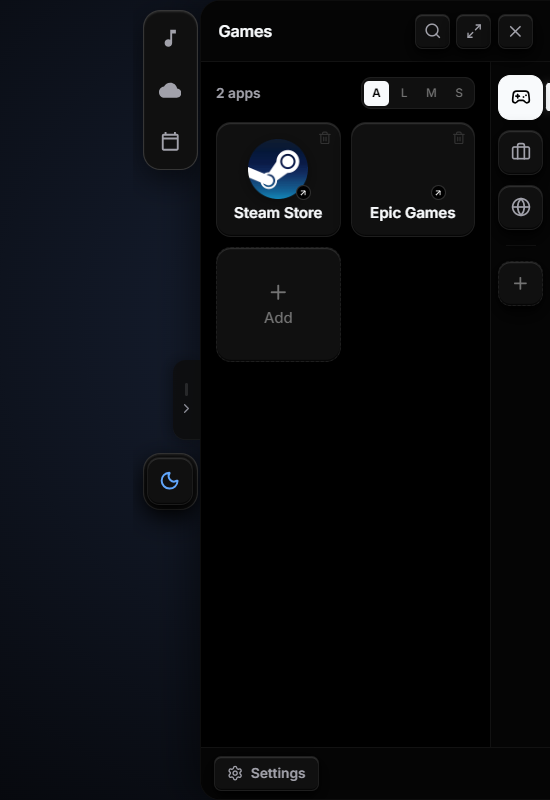 | 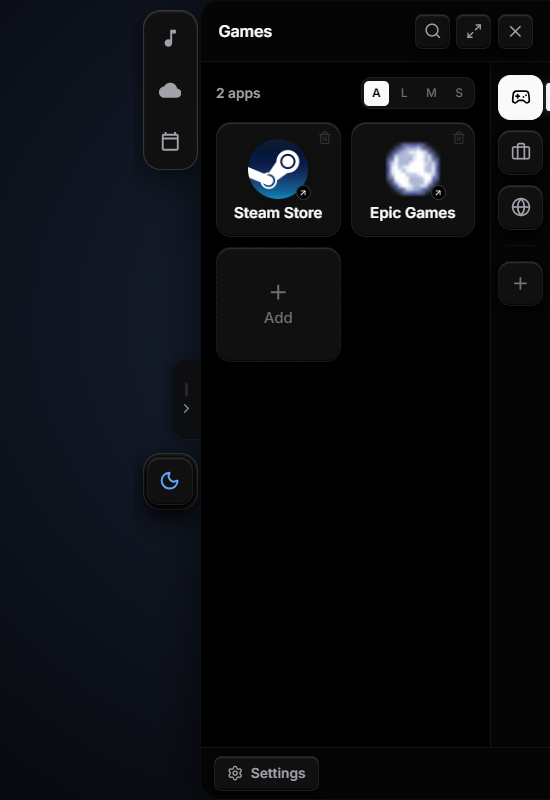 |
| *Comfortable, prominent app tiles* | *Balanced default grid density* | *Compact, high-density dashboard* |

---

### Quick Icons

Pin your most essential apps and links right to the companion anchor column for instant 1-click launching:

| Quick Icons Companion Rail | Add to Quick Icons Modal |
|:---:|:---:|
|  | 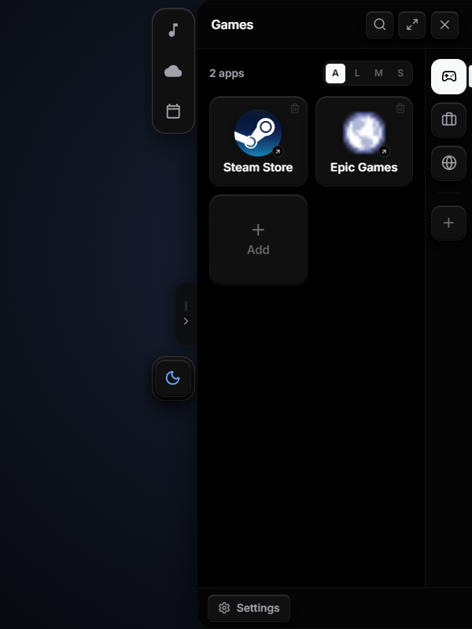 |
| *Persistent quick-launcher pinned along the edge column* | *Search and instantly pin apps across all groups* |

---

### Settings & Quick Update

A restrained utility settings center featuring theme customization, layout sliders, and a single, high-end Quick Update flow:

<p align="center">
  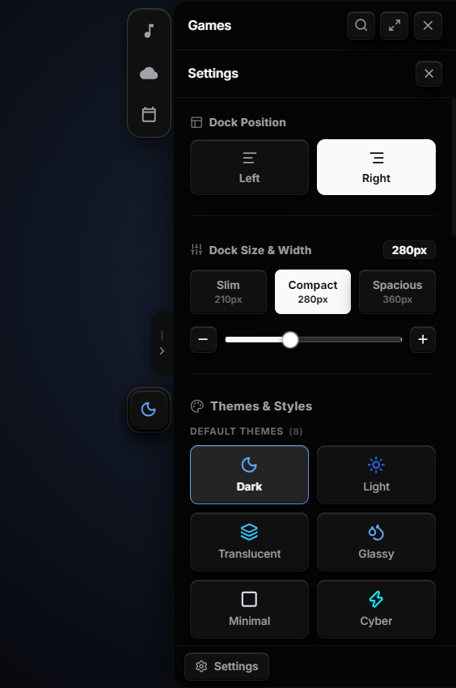
</p>

- **Theme Personalization**: Instant switching across built-in default themes and rich custom themes.
- **Theme Sub-Options**: Toggle sidebar modules, app count badges, and ALMS density selectors.
- **Single Quick Update Button**: One-click update check with clean download loading bar and seamless restart menu.

---

### Custom Aesthetic Themes

Transform AppDock with meticulously crafted custom visual styles, audio cues, and dynamic vertical art:

| Kawaii Theme | Aether Theme |
|:---:|:---:|
| 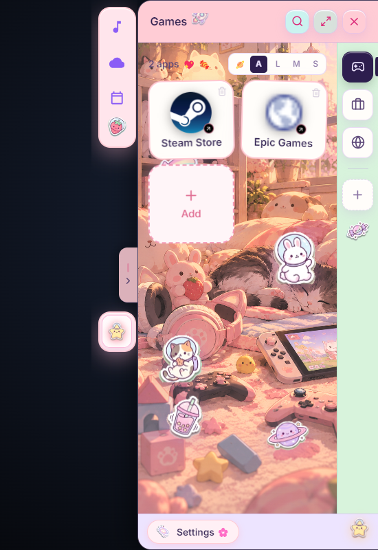 | 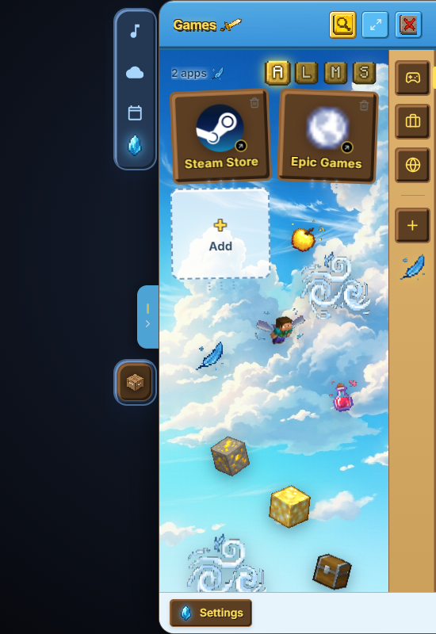 |
| *Pastel pink surfaces, gentle glow, and cute badges* | *Gilded celestial gold borders with Minecraft Aether aesthetic* |

| Death Note Theme | Elden Ring Theme |
|:---:|:---:|
| 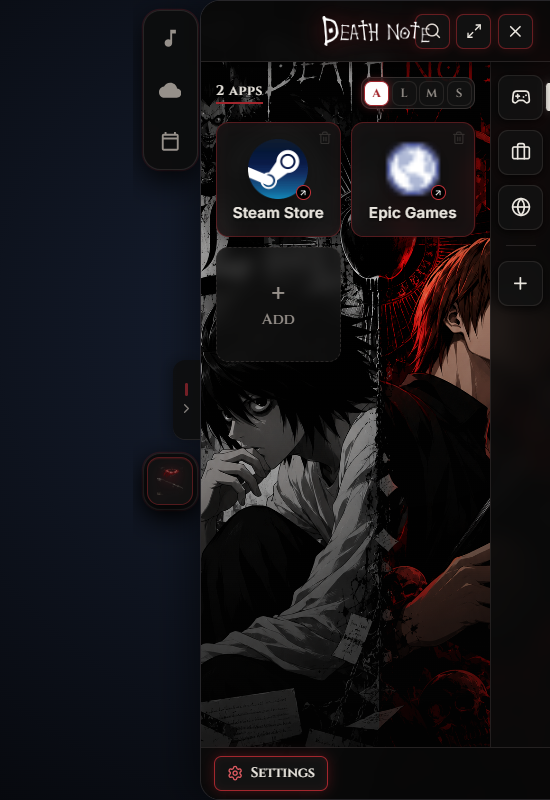 | 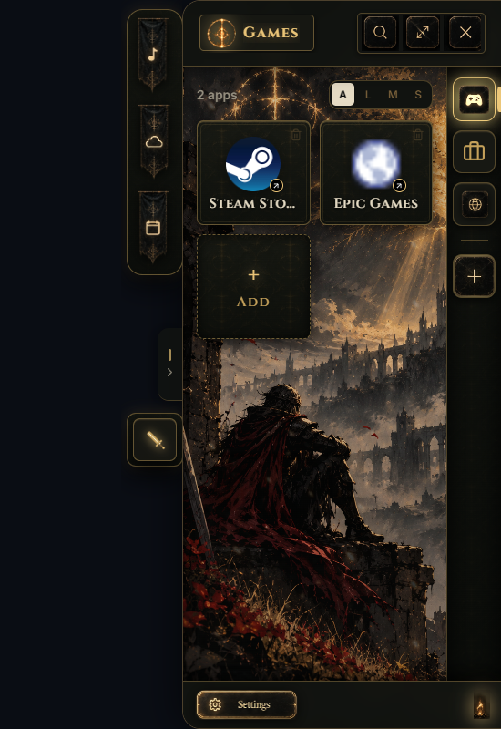 |
| *Gothic Ryuk aesthetic with crimson accents and chain borders* | *Tarnished dark gold grace with Erdtree vertical artwork* |

| One Piece Theme | Candy Theme |
|:---:|:---:|
| 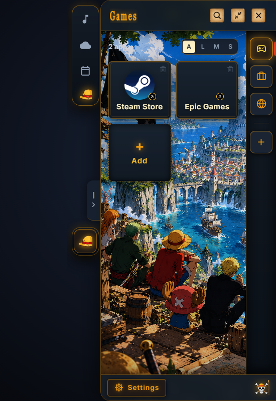 | 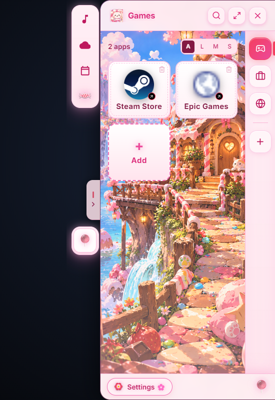 |
| *Vibrant anime pirate aesthetic with themed group typography* | *Sweet candy tones with soft gradients and pastel flair* |

---

## Core Features

- **Multi-Edge Snapping**: Dock smoothly to the left, right, or top edges of your display.
- **Auto-Hide & Edge Tabs**: Seamlessly slides off-screen when inactive; hover or click edge tabs to invoke instantly.
- **Application & URL Launcher**: Pin native executables (`.exe`), shortcuts (`.lnk`), and web URLs with automated icon/favicon extraction.
- **Quick System Scanner**: Automatically scans Start Menu and Windows directories for installed software.
- **Categorized Groups**: Organize your workspace into distinct categories with custom icons and color tags.
- **Quick Icons Bar**: Fast 1-click access pinned alongside the companion anchor column.
- **Companion Modules**: Live Weather, Calendar holidays, and Music media controller widgets.
- **Auto-Updater**: Single-button check with clean real-time download loading bar and instant restart installation.
- **Local-First & Offline**: 100% offline local storage with zero cloud dependencies or telemetry.

---

## Tech Stack

- **Runtime**: [Electron 32](https://www.electronjs.org/) (Chromium + Node.js)
- **Frontend**: [React 19](https://react.dev/), [TypeScript 5.7](https://www.typescriptlang.org/)
- **Bundler**: [Vite 6](https://vitejs.dev/)
- **Styling**: Tailwind CSS & CSS Custom Properties
- **Icons**: [Lucide React](https://lucide.dev/)
- **Packaging**: [electron-builder](https://www.electron.build/)

---

## Getting Started

### Prerequisites

- **Node.js**: `v20.x` or higher
- **npm**: `v10.x` or higher
- **OS**: Windows 10 / 11

### Installation

```bash
# Clone the repository
git clone https://github.com/DevlopTecy/AppDock.git
cd AppDock

# Install dependencies
npm install
```

### Running in Development

```bash
# Run the web frontend in Vite dev server (http://localhost:5173)
npm run dev

# Run the complete Electron desktop app with live reload
npm run dev:electron
```

### Running Tests

Execute the comprehensive 14-suite automated test pipeline:

```bash
npm test
```

### Building for Production

Compile TypeScript and generate the optimized production bundle:

```bash
npm run build
```

Package the native Windows installer (`.exe` NSIS installer):

```bash
npm run dist
```

The installer will be generated in the `release/` directory.

---

## Project Structure

```
Project 5_AppDock/
├── docs/
│   └── screenshots/       # Showcase screenshots for README
├── electron/              # Electron main process, preload bridge, and helpers
│   ├── main.cjs           # Window management, auto-updater, IPC handlers, tray
│   ├── preload.cjs        # Secure ContextBridge APIs
│   └── icon-helper.ps1    # PowerShell native shortcut icon extraction engine
├── src/                   # React 19 application
│   ├── components/        # DockFrame, AppGrid, QuickIconsBar, SettingsView, Modals
│   ├── hooks/             # Custom theme and state hooks
│   ├── types/             # TypeScript definitions
│   ├── utils/             # Local storage, URLs, assets, holidays
│   ├── App.tsx            # Root dock orchestrator
│   └── main.tsx           # React mounting entrypoint
├── public/                # Themes, wallpapers, sound effects, stickers
├── scripts/               # Screenshot generation and release automation tools
└── tests/                 # 14 automated unit and integration test suites
```

---

## License

Distributed under the MIT License. See [LICENSE](LICENSE) for more information.
