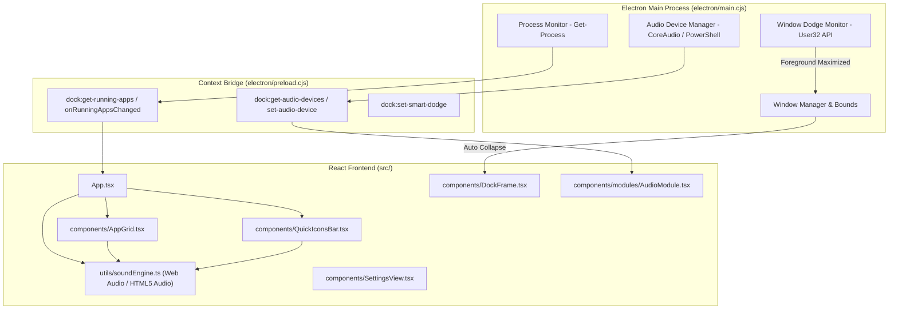

# AppDock: Future Feature Implementation Plan (FX Audio, Smart Dodge, Running Indicators, Audio Switcher)

> **For agentic workers:** REQUIRED SUB-SKILL: Use `superpowers:subagent-driven-development` (recommended) or `superpowers:executing-plans` to implement this plan task-by-task. Steps use checkbox (`- [ ]`) syntax for tracking.

---

## 1. Goal Description

This implementation plan details the architecture, IPC interfaces, React components, and automated test strategies for four high-impact features selected by the user for future implementation in **AppDock**:

1. **Feature 1 (Item 9) — Thematic Sound FX Engine (Haptic Audio)**:
   Acoustic feedback on dock expansion, collapse, card hover, icon clicks, theme changes, and updates. Includes theme-specific sound packs (Elden Ring, Death Note, Kawaii, Mechanical, Clean) with volume and mute controls in Settings.

2. **Feature 2 (Item 10) — Active Window Dodge (Smart Auto-Hide)**:
   Native Windows window-state monitoring. When a foreground application is maximized or running in true fullscreen (e.g., games, video editors, full-screen IDEs), AppDock automatically conceals itself and suppresses edge triggers so it never interferes with full-screen work.

3. **Feature 3 (Item 6) — Running App Indicators (Live Dots)**:
   Lightweight background process scanning that matches running Windows executables (`.exe`) to pinned apps in `AppGrid` and `QuickIconsBar`. Displays an elegant illuminated status dot and enables right-click *Bring to Front* / *Close*.

4. **Feature 4 (Item 5) — Audio Device & Volume Quick-Switcher (Companion Module)**:
   A dedicated companion rail module (`Volume2` / `Headphones` icon) allowing instant 1-click toggling between audio playback devices (Headphones vs. Desktop Speakers) and master volume adjustment without opening Windows Control Panel.

---

## 2. Architecture & Dependency Flow



---

## 3. Proposed Changes

### Feature 1: Thematic Sound FX Engine (Haptic Audio)

#### [NEW] `src/utils/soundEngine.ts`
- Singleton audio manager using Web Audio API + HTML5 Audio.
- Preloads short acoustic bites per theme pack:
  - `clean`: Subdued soft click, modern card pop.
  - `mechanical`: Tactile switch click (blue/brown switch acoustics).
  - `eldenring`: Golden grace chime, stone parchment slide.
  - `deathnote`: Dramatic ink stroke, bell chime.
  - `kawaii`: Pastel bubble pop, twinkle chime.
  - `aether`: Crystal chime, celestial chord.
- Exports:
  - `playSound(event: 'expand' | 'collapse' | 'hover' | 'launch' | 'click' | 'update')`
  - `setSoundEnabled(enabled: boolean)`
  - `setSoundVolume(volume: number)` // 0 to 1
  - `setSoundPack(pack: SoundPackType)`

#### [MODIFY] `src/types/dock.ts`
- Add sound settings to `DockSettings`:
  ```ts
  soundEnabled?: boolean;
  soundVolume?: number; // 0 - 100
  soundPack?: 'theme' | 'clean' | 'mechanical' | 'kawaii' | 'eldenring' | 'deathnote' | 'aether';
  ```

#### [MODIFY] `src/components/SettingsView.tsx`
- Add Sound FX section in Settings with:
  - Master Mute / Enable toggle.
  - Volume slider (0% to 100%).
  - Sound Pack selector (`Match Active Theme`, `Clean Modern`, `Mechanical Switch`, etc.).

---

### Feature 2: Active Window Dodge (Smart Auto-Hide)

#### [MODIFY] `electron/main.cjs`
- Implement foreground window detection in Windows using `user32.dll` APIs (`GetForegroundWindow`, `GetWindowPlacement`).
- When smart dodge is enabled:
  - If a foreground window is maximized, automatically collapse dock and suppress edge toggle sensitivity.
  - When returning to desktop or non-maximized windows, restore normal responsiveness.

#### [MODIFY] `src/types/dock.ts` & `src/utils/storage.ts`
- Add `smartWindowDodge: boolean` (default: `false` or opt-in) to `DockSettings`.

---

### Feature 3: Running App Indicators (Live Dots)

#### [MODIFY] `electron/main.cjs` & `electron/preload.cjs`
- IPC Handler: `dock:get-running-processes`:
  - Periodically executes lightweight process query (`Get-Process`).
  - Returns array of active process base names: `['chrome', 'code', 'discord', 'spotify', 'notepad']`.
- Pushes `dock:running-apps-updated` event to renderer every 4 seconds.

#### [MODIFY] `src/components/AppGrid.tsx` & `src/components/QuickIconsBar.tsx`
- Compute running state for each `AppItem`:
  ```ts
  const isRunning = runningProcessList.some(p => 
    item.target.toLowerCase().includes(p.toLowerCase()) || 
    item.name.toLowerCase().includes(p.toLowerCase())
  );
  ```
- Render a 4px luminous indicator dot below the icon (glowing green or theme accent dot).
- Context menu options: *"Bring to Front"* or *"Close Process"*.

---

### Feature 4: Audio Device & Volume Quick-Switcher

#### [NEW] `electron/audio-helper.ps1`
- Native PowerShell CoreAudio bridge to query Windows playback endpoints:
  - Enumerates audio devices (Device ID, Friendly Name, IsDefault).
  - Switches default audio endpoint using Windows Multimedia API.

#### [NEW] `src/components/modules/AudioModule.tsx`
- Compact companion module in the companion rail:
  - Displays list of output devices with radio toggle (Headphones vs Speakers).
  - Volume slider with mute button.

#### [MODIFY] `src/types/dock.ts`
- Add `'audio'` to `CompanionModuleType`:
  ```ts
  export type CompanionModuleType = 'music' | 'weather' | 'calendar' | 'audio' | null;
  ```

#### [MODIFY] `src/components/connectors/ConnectorHub.tsx`
- Add audio module icon (`Volume2` / `Headphones`) to the rail.

---

## 4. Step-by-Step Execution Plan

### Phase 1: Thematic Sound FX Engine
- [ ] **Step 1.1**: Create `src/utils/soundEngine.ts` with Web Audio API synthesizer chimes and sound asset loaders.
- [ ] **Step 1.2**: Wire sound triggers into `DockFrame` (expand/collapse), `AppGrid` (item click), and `QuickIconsBar`.
- [ ] **Step 1.3**: Add Sound FX toggles and volume slider to `SettingsView.tsx`.
- [ ] **Step 1.4**: Write unit tests in `tests/sound-engine.test.cjs`.

### Phase 2: Running App Indicators
- [ ] **Step 2.1**: Implement `dock:get-running-processes` IPC in `electron/main.cjs` and expose via `electron/preload.cjs`.
- [ ] **Step 2.2**: Connect process subscription in `App.tsx` and pass `runningProcesses` down to `AppGrid` and `QuickIconsBar`.
- [ ] **Step 2.3**: Style luminous status dots with theme-aware accents.
- [ ] **Step 2.4**: Add unit tests in `tests/running-indicators.test.cjs`.

### Phase 3: Active Window Dodge
- [ ] **Step 3.1**: Implement window state detector in `electron/main.cjs` to detect maximized foreground windows.
- [ ] **Step 3.2**: Add `smartWindowDodge` setting toggle in `SettingsView.tsx`.
- [ ] **Step 3.3**: Verify graceful collapse and edge tab suppression when full-screen apps are active.
- [ ] **Step 3.4**: Write test coverage in `tests/window-dodge.test.cjs`.

### Phase 4: Audio Device & Volume Quick-Switcher
- [ ] **Step 4.1**: Create `electron/audio-helper.ps1` for querying and setting default playback devices.
- [ ] **Step 4.2**: Register IPC handlers `dock:get-audio-devices` and `dock:set-audio-device`.
- [ ] **Step 4.3**: Build `src/components/modules/AudioModule.tsx` with device switching and volume control.
- [ ] **Step 4.4**: Mount Audio module in `ConnectorHub.tsx` and test end-to-end.

---

## 5. Verification Plan

### Automated Tests
```bash
# Verify TypeScript & Vite compilation
npm run build --prefix "projects/Project 5_AppDock"

# Run existing and new test suites
npm test --prefix "projects/Project 5_AppDock"
```

### Manual Verification
1. **Sound FX**: Enable sound in settings, switch themes, and verify appropriate acoustic cues play on expand and click.
2. **Running Indicators**: Launch Chrome or Notepad, verify green live dot appears beneath pinned shortcut.
3. **Smart Dodge**: Maximize a window, ensure dock stays out of the way; minimize or show desktop, ensure dock becomes responsive.
4. **Audio Switcher**: Click audio icon on companion rail, switch output to headphones and back, verify Windows audio output changes.
